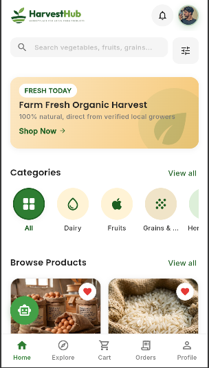
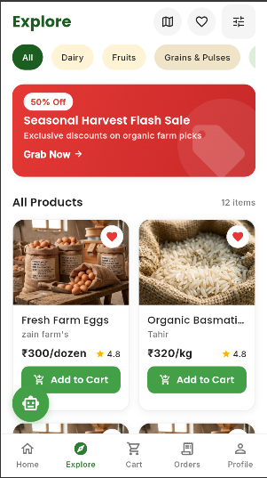
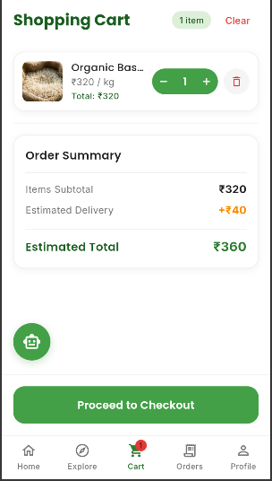
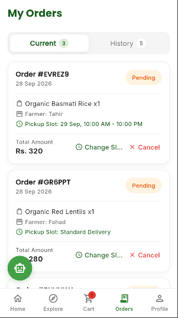

# HarvestHub

A farming marketplace app connecting farmers and buyers, where users can explore fresh farm products, add them to the cart and place orders.

**Tech stack:** Flutter, Firebase, GetX

## Features
- Browse and explore farm products
- Product listing from farmers
- Shopping cart and checkout
- Order tracking (My Orders)
- Firebase authentication and database

## Screenshots

  
  
  
  

---
Built by [Tahir Khan](https://github.com/tahirkhan8709)
